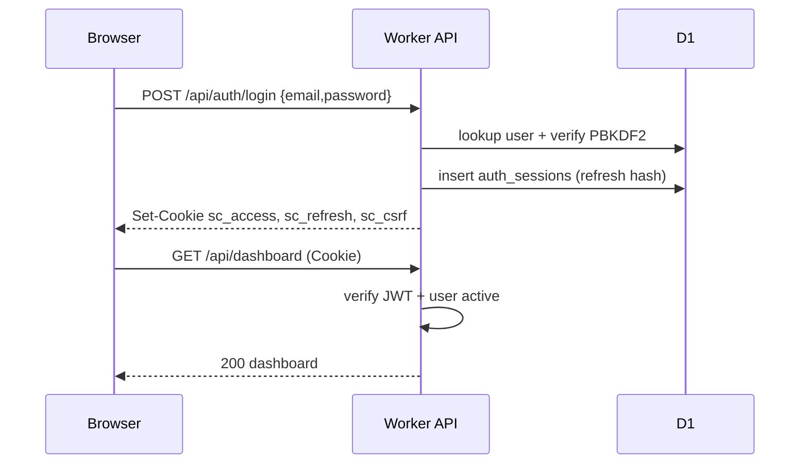

# Speak Coach — Authentication Flow

**Updated:** 2026-07-17  
**Companion:** [CODE-REVIEW.md](./CODE-REVIEW.md) · [TESTING.md](./TESTING.md)

Production email authentication with JWT access tokens, HttpOnly refresh cookies, OTP verification, and multi-user accounts.

---

## TL;DR

| Concept | Implementation |
|---|---|
| Identity | Per-user UUID rows in `users` |
| Credential | Email + password (PBKDF2-SHA-256, **100k** iterations — Cloudflare Workers platform max) |
| Access token | JWT HS256, **15 minutes**, HttpOnly cookie `sc_access` |
| Refresh token | Opaque token, **30 days**, HttpOnly cookie `sc_refresh` (path `/api/auth`) |
| CSRF | Double-submit cookie `sc_csrf` + `X-CSRF-Token` header |
| Email verify | 6-digit OTP, 10 min expiry, 5 attempts, 60s resend |
| Password reset | OTP → new password → all sessions revoked |
| WebSocket | `POST /api/auth/ws-token` → short-lived JWT (`ws_token` query, 60s) |

**Removed:** `APP_SECRET`, shared Bearer token, `user-1`, `DEV_ACCESS_CODE`, `NEXT_PUBLIC_APP_SECRET`, fail-open middleware, localStorage JWTs.

---

## User journeys

```text
Welcome (/auth)
  → Register → Verify email (OTP) → Profile setup → Daily goal → Dashboard

Returning
  → Login → Dashboard (or profile setup if incomplete)
```

---

## API

| Method | Path | Auth |
|---|---|---|
| POST | `/api/auth/register` | Public |
| POST | `/api/auth/verify-email` | Public (sets session cookies on success) |
| POST | `/api/auth/resend-otp` | Public |
| POST | `/api/auth/login` | Public |
| POST | `/api/auth/logout` | Access + CSRF |
| POST | `/api/auth/refresh` | Refresh cookie |
| GET | `/api/auth/me` | Access |
| POST | `/api/auth/forgot-password` | Public |
| POST | `/api/auth/reset-password` | Public |
| POST | `/api/auth/ws-token` | Access + CSRF |
| GET/DELETE | `/api/auth/sessions` | Access (+ CSRF on delete) |
| PATCH | `/api/auth/profile-setup` | Access + CSRF |

All other `/api/*` routes require a valid access JWT (cookie or `Authorization: Bearer`).

---

## Frontend pages

| Route | Purpose |
|---|---|
| `/auth` | Welcome |
| `/auth/login` | Email + password |
| `/auth/register` | Create account |
| `/auth/verify-email` | 6-digit OTP |
| `/auth/forgot-password` | Request reset OTP |
| `/auth/reset-password` | OTP + new password |
| `/profile/setup` | Learning goal + daily minutes |
| `/sign-in`, `/sign-up` | Redirect to `/auth/*` |

Client storage: **CSRF token only** in `localStorage` (`speak-coach-csrf`). Access/refresh JWTs stay in HttpOnly cookies. API calls use `credentials: "include"`.

---

## Database

Migration `0012_email_auth.sql`:

- Extends `users` with `password_hash`, `email_verified`, `avatar`, `status`, `learning_goal`, `profile_complete`, timestamps
- `auth_sessions` — refresh token hashes + device metadata (named to avoid collision with practice `sessions`)
- `email_verifications`, `password_resets`, `auth_lockouts`, `ws_tokens`, `auth_audit_logs`, `csrf_tokens`

---

## Security controls

- Login lockout: 5 failures → 15 minute lock (`auth_lockouts`)
- OTP: max 5 attempts; hashed at rest (SHA-256)
- Refresh rotation on `/api/auth/refresh`
- CSRF required on mutating authenticated auth routes
- Optional Cloudflare Turnstile (`TURNSTILE_SECRET_KEY`)
- CORS credentials + explicit origin allowlist (no fail-open localhost echo)
- Password reset revokes all refresh sessions

---

## Environment

```bash
# workers/api/.dev.vars
JWT_SECRET=...
AUTH_DEV_EXPOSE_OTP=true   # returns OTP in JSON when email provider missing
RESEND_API_KEY=...         # optional
EMAIL_FROM=...
TURNSTILE_SECRET_KEY=...   # optional

# production
npx wrangler secret put JWT_SECRET
npx wrangler secret put RESEND_API_KEY
```

Web: `NEXT_PUBLIC_API_URL` only (no app secret).

---

## Sequence (login)


