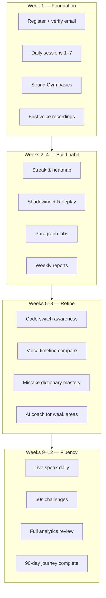

# Speak Coach — Complete Application Flow

> Personal 90-day English & Hindi speaking coach.  
> Web (Next.js PWA) + Mobile (Expo) + API (Cloudflare Workers).

---

## 1. High-Level Architecture

```
┌─────────────────┐     HTTPS + session cookies     ┌──────────────────────────┐
│  Web (Next.js)  │ ───────────────────────────────► │  Cloudflare Worker API │
│  localhost:3000 │   sc_access / sc_refresh / CSRF  │  (Hono) localhost:8787 │
└─────────────────┘                                   └───────────┬──────────────┘
┌─────────────────┐                                           │
│  Mobile (Expo)  │ ──────────────────────────────────────────┤
└─────────────────┘                                           │
                                                              ▼
                    ┌─────────────────────────────────────────────────────┐
                    │  D1 (SQLite)  │  R2 (voice files)  │  Workers AI     │
                    │  Durable Obj  │  Cron (reminders)  │  (Whisper/Llama)│
                    └─────────────────────────────────────────────────────┘
```

| Layer | Path | Role |
|-------|------|------|
| Web app | `apps/web` | UI, PWA, static export to Cloudflare Pages |
| API | `workers/api` | REST + WebSocket coach, auth, scoring |
| Shared types | `packages/shared` | TypeScript contracts between web & API |
| Mobile | `apps/mobile` | Expo tabs (Session, Voice, Coach, etc.) |

---

## 2. User Onboarding Flow

```mermaid
flowchart TD
    A[Open app] --> B{Signed in?}
    B -->|No| C[/auth welcome]
    C --> D[/auth/register]
    D --> E[POST /api/auth/register]
    E --> F[/auth/verify-email OTP]
    F --> G[POST /api/auth/verify-email]
    G --> H[HttpOnly cookies sc_access + sc_refresh]
    H --> I{Profile complete?}
    I -->|No| J[/profile/setup daily goal]
    J --> K[PATCH /api/auth/profile-setup]
    I -->|Yes| L[Practice Hub /]
    K --> L
    B -->|Yes| L
    L --> M[Optional: /profile / /settings]
```

**Auth details**
- Credentials: email + password (PBKDF2-SHA-256, 600k iterations)
- Access JWT: HttpOnly cookie `sc_access` (15 min) or `Authorization: Bearer`
- Refresh: HttpOnly cookie `sc_refresh` (30 days, path `/api/auth`)
- CSRF: cookie `sc_csrf` + header `X-CSRF-Token` on mutating auth routes
- Public routes: `/api/health`, `/api/auth/register`, `/api/auth/login`, `/api/auth/verify-email`, `/api/auth/resend-otp`, `/api/auth/forgot-password`, `/api/auth/reset-password`, `/api/auth/refresh`
- Profile: `GET/PATCH /api/profile` (authenticated)
- WebSocket: `POST /api/auth/ws-token` → short-lived `?ws_token=` (60s)

See [AUTH-FLOW.md](../AUTH-FLOW.md) and [AUTH-MIGRATION.md](./AUTH-MIGRATION.md).

---

## 3. Main Navigation Map

### Bottom / sidebar navigation (5 areas)

| Nav label | Route | What's inside |
|-----------|-------|----------------|
| **Practice Hub** | `/` | Category tabs: Speaking, Skills, Writing, extras |
| **Dashboard** | `/dashboard` | Streak, missions, analytics snapshot, mistakes |
| **Learn** | `/session` | Daily session, journey, curriculum, homework |
| **Progress** | `/analytics` | Charts, heatmaps, reports, voice library |
| **Coach** | `/coach` | AI chat (HTTP / SSE / WebSocket) |

**Explore all features:** `/explore` (searchable catalog of 30+ tools)

---

## 4. Recommended Daily Practice Flow

```mermaid
flowchart LR
    subgraph morning [Morning — 15–20 min]
        S1[Daily Session /session]
        S2[Sound Gym or Shadowing]
    end
    subgraph afternoon [Anytime speaking]
        S3[Live Speak /live-speak]
        S4[Roleplay or 60s Challenge]
    end
    subgraph writing [Writing]
        S5[Paragraph Write /paragraphs/write]
        S6[Read Aloud /paragraphs/read]
    end
    subgraph evening [Evening wrap-up]
        S7[Grammar Fix /correct]
        S8[Night Review /night-review]
        S9[Check Dashboard /dashboard]
    end
    morning --> afternoon --> writing --> evening
```



### Step-by-step (typical day)

| # | Step | Page | API | Data saved |
|---|------|------|-----|------------|
| 1 | Complete 10-step session | `/session` | `POST /api/sessions`, `PATCH` steps/scores | `sessions`, `session_steps` |
| 2 | Train pronunciation | `/sound-gym` | `POST /api/sound-gym/complete` | `sound_gym_progress` |
| 3 | Speak with live transcript | `/live-speak` | `POST /api/voice/upload` (category: `live_speak`) | `voice_recordings` + R2 |
| 4 | Fix grammar mistakes | `/correct` | `POST /api/correct/roman-hindi` or `/english` | `corrections`, `mistakes` |
| 5 | Write a paragraph | `/paragraphs/write` | `POST /api/paragraphs/write` | `paragraph_writes` + `diff_json` |
| 6 | Read paragraph aloud | `/paragraphs/read` | `POST /api/paragraphs/read` | `paragraph_reads` + `alignment_json` |
| 7 | Review progress | `/analytics` | `GET /api/analytics` | (read-only) |
| 8 | Night recap | `/night-review` | `GET /api/night-review` | (read-only) |

**Streak rule:** A practice day counts when `sessions.completed_steps >= 10`.  
**Streak freeze:** 1 per week via `POST /api/streak/freeze`.

---

## 5. Feature Flows (Detailed)

### 5.1 Daily Session (`/session`)

```
User opens /session
    → GET /api/sessions/today
    → If no session: POST /api/sessions (creates 10 steps)
    → User completes each step
    → PATCH /api/sessions/:id/step
    → PATCH /api/sessions/:id/scores (pronunciation, loudness, etc.)
    → completed_steps reaches 10 → streak + dashboard update
    → Optional: POST homework assign
```

### 5.2 Voice Recording Pipeline (all voice features)

```
User records audio (VoiceRecorder / LiveVoiceRecorder)
    → Client: loudness, pitch, waveform samples
    → Optional: user types transcript
    → POST /api/voice/upload (FormData: audio, transcript, category, analytics)
    → Server: Whisper transcription if no transcript
    → Server: scoreVoiceAnalytics() → clarity, pace, fillers
    → Save to voice_recordings + R2
    → Return scored analytics to UI
```

**Categories:** `practice`, `live_speak`, `challenge`, `session`, `shadowing`, `paragraph_read`, `roleplay`, `general`

**Where recordings appear:**
- `/voice` — latest scores
- `/voice-timeline` — unified chart (voice + shadowing + read-aloud)
- `/voice-library` — browse, play, download, before/after compare
- `/analytics` — totals and trends

### 5.3 Shadowing (`/shadowing`)

```
GET /api/shadowing/today → sentence of the day
User listens → records → POST /api/shadowing/attempt
    → Whisper transcript + word alignment
    → Scores: accuracy, pace, volume, overall
    → Saved to shadowing_attempts + R2
```

### 5.4 Roleplay (`/roleplay`)

```
GET /api/roleplay/scenarios
User picks scenario → turn-by-turn conversation
POST /api/roleplay/turn (audio or text)
    → AI feedback per turn
    → Saved to roleplay_sessions
```

### 5.5 Grammar Fix (`/correct`)

```
Tab: Fix text
    → POST /api/correct/roman-hindi OR /api/correct/english
    → Rule engine + optional Workers AI enhance
    → Save to corrections + update mistakes dictionary

Tab: History
    → GET /api/correct/history
    → Expand to see input vs corrected preview
```

### 5.6 Paragraph Labs

**Write** (`/paragraphs/write`)
```
User submits paragraph
    → POST /api/paragraphs/write
    → analyzeParagraph() → diff, mistakes, accuracy
    → ParagraphDiffView shows word-by-word comparison
    → Stored in paragraph_writes (diff_json)
```

**Read** (`/paragraphs/read`)
```
GET /api/paragraphs/daily → today's paragraph from curriculum
User records reading
    → POST /api/paragraphs/read (audio + sourceText)
    → alignWords() → pronunciation accuracy
    → WordAlignmentView shows per-word correct/wrong/skipped
    → Stored in paragraph_reads (alignment_json)
```

**History** (`/paragraphs/history`)
```
GET /api/paragraphs/writes + /reads (list)
Tap item → GET /api/paragraphs/writes/:id or /reads/:id
    → Full diff or alignment loaded from DB
```

### 5.7 Code-Switch Tracker (`/code-switch`)

```
User pastes Hinglish text
    → POST /api/code-switch/analyze
    → Word classification: English / Hindi / mixed
    → Ratios + tip + word tags displayed
    → Logged for history & stats
```

### 5.8 AI Coach (`/coach`)

```
User sends message
    → Option A: POST /api/coach/chat
    → Option B: SSE /api/coach/stream
    → Option C: WebSocket /api/coach/ws (Durable Object)
    → Workers AI Llama responds with bilingual coaching
    → Session history in coach_sessions table
```

### 5.9 Progress & Analytics

**Analytics** (`/analytics`)
```
GET /api/analytics
    → Goals, weekly/monthly stats, practice mix pie charts
    → Fluency trend, top mistakes, corrections by type
GET /api/practice-heatmap → 12-week practice calendar
GET /api/analytics/insights → AI-generated tips
```

**Weekly Report** (`/reports`)
```
GET /api/reports/weekly → JSON summary
GET /api/reports/weekly/html → Print / Save PDF
POST /api/reports/weekly/email → Send via Resend (if configured)
Settings: weekly_report_email toggle
```

**Heatmaps** (`/heatmap`)
```
Tab Practice → GET /api/practice-heatmap (speaking minutes)
Tab Mistakes → GET /api/heatmap (error density)
```

**Dashboard** (`/dashboard`)
```
GET /api/dashboard → streak, XP, badges, recent scores
GET /api/journey → 90-day map
GET /api/analytics + insights (parallel)
    → StreakCard, missions, ProgressAnalytics, RecentActivity
```

### 5.10 Sound Gym (`/sound-gym`)

```
GET /api/sound-gym → completed drill IDs from DB
User practices TH, V/W, र, श sounds
Record drill → POST /api/sound-gym/complete
    → Progress persists across sessions
```

### 5.11 Voice Library & Compare (`/voice-library`)

```
Tab Library
    → GET /api/voice/library?category=
    → Play / download via GET /api/voice/:id/audio

Tab Before / After
    → Auto-pick oldest vs latest recording
    → Side-by-side play + loudness/clarity delta
```

### 5.12 Extras

| Page | Flow |
|------|------|
| `/whatsapp` | Paste chat lines → `POST /api/correct/bulk` → line-by-line fixes |
| `/vocabulary` | Spaced repetition → `GET /api/vocabulary/due` |
| `/mistakes` | Flashcards from `GET /api/mistakes` |
| `/journal` | `POST /api/journal` daily confidence entry |
| `/homework` | Auto-assigned after session → `PATCH complete` |
| `/night-review` | Aggregates mistakes + homework + short review |
| `/comeback` | Quick 5-step return after break |
| `/settings` | Goals, reminders, Devanagari, weekly email, export |
| `/profile` | Edit profile, streak card, stats |

---

## 6. Data Model (Key Tables)

| Table | Purpose |
|-------|---------|
| `users` | UUID identity, email, password_hash, email_verified, profile fields |
| `auth_sessions` | Refresh token hashes + device metadata |
| `email_verifications` | Email OTP records |
| `password_resets` | Password reset OTP records |
| `auth_lockouts` | Login rate limiting |
| `user_settings` | Reminders, daily goal, streak freezes, weekly email |
| `sessions` | Daily session scores & completed_steps |
| `session_steps` | Per-step status & duration |
| `voice_recordings` | Audio metadata, scores, category, R2 key |
| `shadowing_attempts` | Shadowing scores + audio |
| `paragraph_writes` | Text + diff_json + mistakes |
| `paragraph_reads` | Alignment_json + pronunciation scores |
| `corrections` | Every grammar/Roman Hindi fix |
| `mistakes` | Recurring wrong→correct dictionary |
| `sound_gym_progress` | Completed pronunciation drills |
| `code_switch_logs` | Hinglish analysis history |
| `homework` | Post-session tasks |
| `journal_entries` | Confidence journal |
| `coach_sessions` | AI coach chat history |

---

## 7. API Endpoint Map

| Prefix | Main endpoints |
|--------|----------------|
| `/api/auth` | register, verify-email, login, logout, refresh, me, forgot/reset password, ws-token, sessions, profile-setup |
| `/api/profile` | GET, PATCH |
| `/api/dashboard` | GET |
| `/api/sessions` | today, create, step, scores |
| `/api/correct` | roman-hindi, english, bulk, **history** |
| `/api/paragraphs` | write, read, daily, writes, reads, **:id detail** |
| `/api/voice` | upload, library, timeline, :id/audio, transcribe-chunk |
| `/api/shadowing` | today, attempt |
| `/api/roleplay` | scenarios, turn |
| `/api/analytics` | GET, /insights |
| `/api/reports` | weekly, weekly/html, **weekly/email** |
| `/api/heatmap` | mistake heatmap |
| `/api/practice-heatmap` | practice calendar |
| `/api/journey` | 90-day map |
| `/api/streak` | GET, freeze |
| `/api/sound-gym` | GET, complete |
| `/api/code-switch` | analyze, history, stats |
| `/api/coach` | chat, stream, ws |
| `/api/settings` | GET, PATCH |
| `/api/export` | backup, summary |
| `/api/push` | register, vapid key |

---

## 8. Complete Page Index (37 routes)

| Route | Feature |
|-------|---------|
| `/` | Practice Hub (home) |
| `/dashboard` | Overview, streak, missions |
| `/session` | Daily 10-step session |
| `/journey` | 90-day progress map |
| `/curriculum` | Weekly themes & lessons |
| `/homework` | Assigned tasks |
| `/live-speak` | Real-time speaking + transcript |
| `/shadowing` | Listen & repeat scoring |
| `/roleplay` | Scenario conversations |
| `/challenge` | 60-second fluency burst |
| `/listen-repeat` | Comprehension drill |
| `/sound-gym` | Pronunciation lab (DB progress) |
| `/correct` | Grammar fix + history |
| `/vocabulary` | Word learning & review |
| `/code-switch` | Hinglish mix analysis |
| `/mistakes` | Mistake dictionary flashcards |
| `/paragraphs/write` | Paragraph correction |
| `/paragraphs/read` | Read aloud + alignment |
| `/paragraphs/history` | Past writes/reads with diff |
| `/analytics` | Charts, heatmap, insights |
| `/reports` | Weekly report + PDF + email |
| `/heatmap` | Practice & mistake calendars |
| `/voice` | Voice practice + scoring |
| `/voice-timeline` | Unified recording chart |
| `/voice-library` | Library + before/after |
| `/coach` | AI coach chat |
| `/journal` | Confidence journal |
| `/night-review` | Bedtime recap |
| `/phrases` | Saved phrasebook |
| `/whatsapp` | Bulk chat correction |
| `/comeback` | Return-after-break mode |
| `/explore` | All features catalog |
| `/profile` | Account & streak |
| `/settings` | Preferences & export |
| `/auth` | Welcome — register or login |
| `/auth/login` | Email + password |
| `/auth/register` | Create account |
| `/auth/verify-email` | Email OTP |
| `/auth/forgot-password` | Request reset OTP |
| `/auth/reset-password` | OTP + new password |
| `/profile/setup` | Learning goal + daily minutes |
| `/sign-in`, `/sign-up` | Redirect to `/auth/*` |
| `/launch` | Production checklist |

---

## 9. Scheduled Jobs (Cron)

Every **15 minutes** the Worker runs:

1. **Daily reminders** — push notification if `reminder_enabled` and time matches
2. **Weekly email** — Sunday 08:00 UTC, if `weekly_report_email` enabled and Resend configured

---

## 10. Local Development

```bash
# One-time setup
npm install
cd workers/api && npm run db:migrate && npm run db:seed

# workers/api/.dev.vars
# JWT_SECRET=dev-secret-at-least-32-characters-long
# AUTH_DEV_EXPOSE_OTP=true   # returns OTP in JSON when email not configured

# Run (two terminals or monorepo dev)
npm run dev
# Web:  http://localhost:3000
# API:  http://localhost:8787

# Web only needs NEXT_PUBLIC_API_URL (no app secret)
# apps/web/.env.local → NEXT_PUBLIC_API_URL=http://localhost:8787
```

**Apply new migrations after pull:**
```bash
cd workers/api && npx wrangler d1 migrations apply speak-coach --local
```

---

## 11. User Journey Diagram (Full 90 Days)



---

## 12. What Gets Tracked Automatically

| Action | Tracked in |
|--------|------------|
| Complete daily session | `sessions`, streak |
| Voice recording | `voice_recordings`, analytics totals |
| Shadowing attempt | `shadowing_attempts`, unified timeline |
| Read aloud | `paragraph_reads`, unified timeline |
| Grammar correction | `corrections`, `mistakes` |
| Paragraph write | `paragraph_writes` |
| Sound gym drill | `sound_gym_progress` |
| Code-switch analysis | `code_switch_logs` |
| Coach chat | `coach_sessions` |
| Practice goal met | `practice-heatmap`, analytics goal % |

---

*Document version: reflects email auth (JWT cookies, OTP, multi-user) and Phase 15+ enhancements.*
